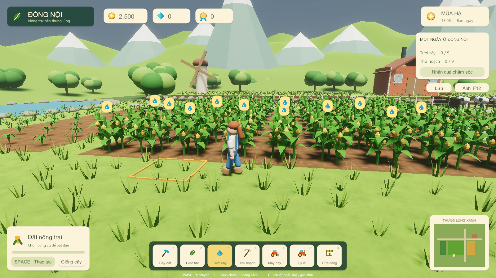
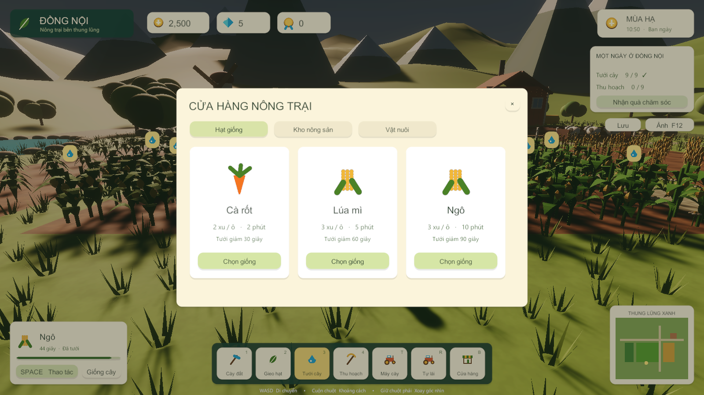

# NextGen Farm — Unity HDRP

Project nông trại 3D cho Windows, dùng **Unity 6000.0.62f1 / HDRP 17.0.4**. Game web cũ đã được đưa vào Thùng rác; thư mục này giờ là project Unity. Giữ lịch sử Git để có thể truy vết thay đổi.

## Mở và chơi

**Tải bản Windows chơi ngay:** mở [GitHub Releases](https://github.com/hoangquann147/nextgen-farm/releases/latest), tải `NextGenFarm-Windows-x64.zip`, giải nén toàn bộ, rồi nhấp đúp `CHOI-GAME.cmd`. Không cần cài Unity. Đây là bản prototype để thử nghiệm, chưa có co-op.

Trong source project, `XEM-DEMO.cmd` mở nông trại demo có sẵn cây và chuồng; lần đầu chạy sẽ điều chỉnh mốc thời gian demo về hiện tại. Demo lưu riêng trong `DemoFarm/Save-v2`.

- Nhấp đúp **`CHOI-GAME.cmd`** để chơi bản Windows. Nếu chưa có bản build, script dùng Unity đã cài để build trước rồi mở game.
- Nhấp đúp **`MO-UNITY.cmd`** để mở project trong Editor. Lần mở đầu sẽ import package, tự tạo cấu hình HDRP, material và scene `Assets/FarmGenerated/FarmDemo.unity`. Chờ import xong rồi nhấn Play.
- Nhấp đúp **`BUILD-GAME.cmd`** để build lại. Hoặc dùng menu **NextGen Farm → Build Windows Player** trong Unity.

Bản Windows được tạo tại `Builds/Windows/NextGenFarm.exe`. Muốn chuyển game sang máy khác, copy **toàn bộ thư mục `Builds/Windows`**, bao gồm `NextGenFarm_Data`, `UnityPlayer.dll` và các file đi kèm; không chỉ copy file `.exe`.

Các launcher tìm Unity ở `F:/UnityFarmTools/6000.0.62f1` hoặc đường dẫn Unity Hub mặc định. Với máy khác, cài đúng phiên bản hoặc đặt biến môi trường `UNITY_EDITOR_PATH` trỏ đến `Editor/Unity.exe`. Editor cần license hợp lệ; người chơi bản Windows đã build không cần cài Editor hay đăng nhập Unity.

## Điều khiển

| Phím | Chức năng |
| --- | --- |
| WASD / mũi tên | Đi lại |
| Cuộn chuột | Zoom camera |
| T | Lên/xuống máy cày |
| 1 / 2 / 3 / 4 | Cày / gieo / tưới / thu hoạch |
| Space | Dùng công cụ phía trước; 1×1 khi đi bộ, 3×3 trên máy cày |
| R | Chạy/dừng Auto-Tractor; WASD cũng dừng tự lái |
| B | Mở cửa hàng hạt giống, kho và vật nuôi |
| Giữ chuột phải và kéo | Xoay camera |
| F12 | Chụp ảnh gameplay |
| F / G | Cho ăn / thu sản phẩm chuồng |
| V | Bán nông sản trong kho |
| P | Lưu ngay |
| + / - | Nâng/hạ địa hình phía trước |

Cà rốt chín sau 120 giây; tưới giúp giảm 30 giây một lần/vụ. Mỗi mùa dài 17 phút. Cây và chuồng tiếp tục lớn theo UTC khi offline; cây không héo, thú không chết vì quên chăm sóc. Tự lưu mỗi 30 giây, khi pause và khi thoát game bình thường.

Save nằm trong `%USERPROFILE%/AppData/LocalLow/NextGenFarm/NextGen Farm/nextgen-farm-v1.json`, kèm backup `.bak`. Nếu file chính hỏng, game thử backup. Nếu cả hai không hợp lệ, game hiện thông báo thay vì ghi đè dữ liệu cũ. Kiểm thử tự động dùng thư mục save riêng qua biến `NEXTGEN_FARM_SAVE_DIR`.

## Kiểm tra

```powershell
# Kiểm thử lõi (compiler Roslyn cục bộ có ở máy thực hiện)
./Verification/run.ps1

# Unity import, cấu hình HDRP và JsonUtility/file IO
./Tools/StartFarm.ps1 -Mode Verify

# Build Windows Player
./Tools/StartFarm.ps1 -Mode Build
```

Log build và verify ở `Logs`. Bài kiểm tra Play Mode nằm trong `Assets/Farm/Editor/FarmPlayModeChecks.cs`; báo cáo và kết quả thực tế nằm trong `Verification/REPORT.vi.md`.

## Phạm vi

Hiện có lưới, cây trồng, máy cày/auto, chuồng bò, kho/tiền/bán hàng, save offline, camera, HDRP ngày đêm/thời tiết minh họa và GPU instancing theo chunk. Hình ảnh demo dùng mesh đơn giản; chưa có bộ asset photorealistic, mạng co-op, Town Hub đi lại được hoặc nước vật lý.

Xem `ARCHITECTURE.vi.md` cho kiến trúc, `README.vi.md` cho mô tả luật chi tiết và `CODE_FULL.md` cho bản mã C# ghép để đọc.

## Hình ảnh thực tế




